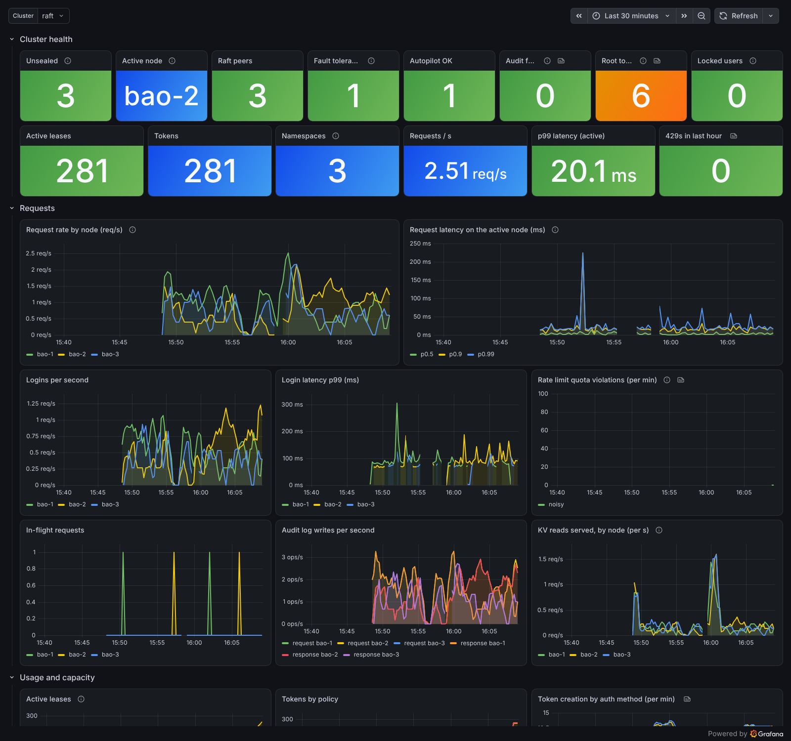
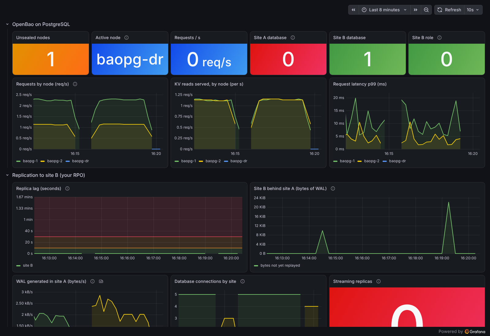
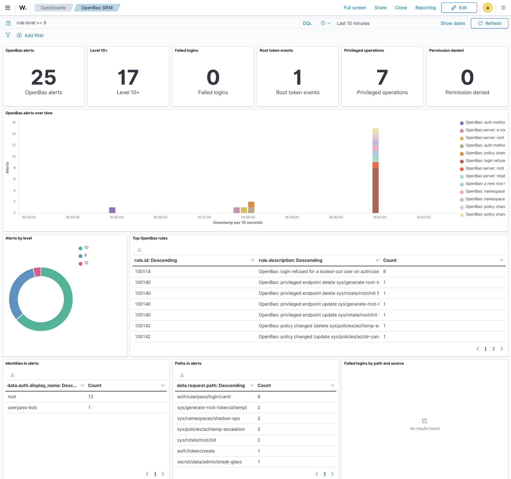
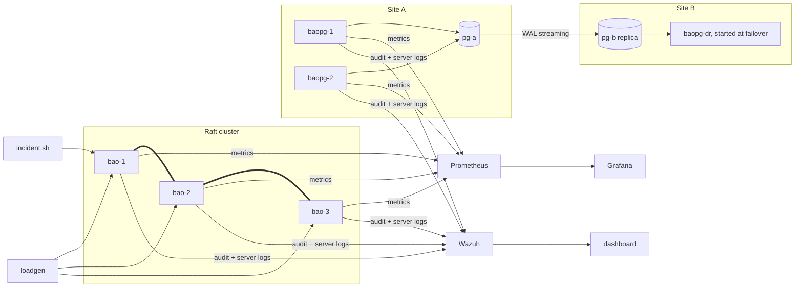

# OpenBao observability lab

A 3-node OpenBao 2.7 cluster with metrics, dashboards and a SIEM, started on a laptop with one command. It is the OpenBao version of [vault-observability-lab](https://github.com/FlavioImbertDomingos/vault-observability-lab): the same Prometheus, Grafana and Wazuh setup, the same load generator and attack script, plus the things OpenBao gives away for free that Vault keeps for Enterprise: standbys that serve reads, namespaces, and a PostgreSQL cluster with a second site for a disaster recovery drill.

Built to answer a practical question: what do you actually get, and give up, when you run the open-source fork instead of Vault?

## What you get

| | |
|---|---|
| OpenBao | 3 Raft nodes on 2.7.3, initialized, unsealed and seeded automatically; audit device declared in the config; JSON server logs |
| Read scaling | Standbys answer reads themselves (`./lab.sh reads` shows it); writes are forwarded to the active node |
| Namespaces | `team-a` and `team-b` with their own mounts, policies and users (`./lab.sh namespaces`) |
| Metrics | Prometheus scraping every node, 15 alert rules, a 42-panel overview dashboard and a PostgreSQL/DR dashboard |
| SIEM | Wazuh manager, indexer and dashboard; 28 rules for OpenBao audit and server logs; an "OpenBao SIEM" dashboard |
| Traffic | Load generator (logins, KV, transit, namespaces, tokens, quota bursts) and `./lab.sh incident` |
| Upgrades | `./lab.sh upgrade <version>`: rolling upgrade, standbys first, active node last, snapshot and autopilot health gates |
| DR drill | `./lab.sh pg up` adds OpenBao on PostgreSQL with a streaming replica in site B; `./lab.sh pg failover [seconds]` loses site A and measures recovery time and data loss |
| Docs | [Architecture](docs/architecture.md), [Findings](docs/findings.md), [Metrics](docs/metrics.md), [SIEM](docs/siem.md), [DR drill](docs/dr.md), [Upgrades](docs/upgrades.md), [OpenBao or Vault?](docs/openbao-vs-vault.md), [Exercises](docs/exercises.md), [Troubleshooting](docs/troubleshooting.md) |

## Screenshots

All taken from a running lab.

| Grafana: OpenBao overview | Grafana: PostgreSQL and DR, after a failover |
|---|---|
|  |  |
| Wazuh: level 9+ findings after `./lab.sh incident` | |
|  | |

## Quick start

Requirements: Docker Desktop (Mac, Windows) or Docker Engine with Compose (Linux), at least 6 GB of memory for Docker, about 6 GB of disk. Intel and Apple Silicon both work. On Linux also run `sudo sysctl -w vm.max_map_count=262144`.

```bash
git clone https://github.com/flavioimbertdomingos/openbao-observability-lab.git
cd openbao-observability-lab
./lab.sh up          # first run: 3 to 6 minutes
./lab.sh status
./lab.sh reads       # which node answered each read
./lab.sh incident    # then open Wazuh > Dashboards > OpenBao SIEM
./lab.sh pg up       # PostgreSQL cluster and site B
./lab.sh pg failover 30
```

The lab uses the same ports as the Vault lab, so run one at a time (or move ports in `.env`).

| Service | URL | Login |
|---|---|---|
| OpenBao | http://localhost:8200 (8210, 8220) | `./lab.sh token` |
| OpenBao on PostgreSQL | http://localhost:8400 (8410; site B 8500) | `./lab.sh token pg` |
| Prometheus | http://localhost:9090 | none |
| Grafana | http://localhost:3000 | admin / baolab |
| Wazuh | https://localhost:8443 | admin / SecretPassword |

Less memory? `./lab.sh core` runs OpenBao, Prometheus and Grafana only (about 1 GB).

| Command | Does |
|---|---|
| `./lab.sh up` | Start everything; unseals OpenBao on later runs |
| `./lab.sh core` | Start without Wazuh |
| `./lab.sh status` | Containers, Raft peers, URLs |
| `./lab.sh reads` | Send 30 reads to each node and count which node served them |
| `./lab.sh namespaces` | List namespaces and show a team admin confined to her namespace |
| `./lab.sh incident` | Simulated attack for the SIEM |
| `./lab.sh pg up` | Start OpenBao on PostgreSQL in site A, a replica in site B, a write canary |
| `./lab.sh pg failover [S]` | Lose site A (optionally after cutting the link to site B for S seconds), promote site B, report RTO and RPO |
| `./lab.sh pg status` / `down` / `reset` | State of both sites; stop; delete and start over |
| `./lab.sh unseal` | Unseal after Docker restarts |
| `./lab.sh token [pg]` | Print a root token |
| `./lab.sh versions` | Version and role of each node |
| `./lab.sh snapshot` | Raft snapshot to `backups/` |
| `./lab.sh upgrade 2.7.3` | Rolling upgrade, no downtime for clients behind a health-checked load balancer |
| `./lab.sh down` | Stop, keep data |
| `./lab.sh reset` | Delete all data, secrets and certificates |

## Accessing OpenBao

```bash
# CLI on your machine (macOS: brew install openbao)
export BAO_ADDR=http://localhost:8200
export BAO_TOKEN=$(./lab.sh token)
bao status
bao operator raft list-peers

# a team user inside a namespace
unset BAO_TOKEN
export BAO_NAMESPACE=team-a
bao login -method=userpass username=ana password=ana-pass
```

The web UI is at http://localhost:8200. Users: alice, bob, carol (root namespace, password `<name>-pass`), ana in team-a, ben in team-b. The `vault` CLI and the Vault Terraform provider talk to OpenBao too, since the API is the same.

## How it works



- Prometheus pulls `/v1/sys/metrics?format=prometheus` from each node. OpenBao kept Vault's metric names (`vault_*`), so Vault dashboards and alerts work unchanged.
- The audit device is declared in `openbao/config/bao.hcl`. OpenBao 2.x refuses `bao audit enable` through the API unless you opt in.
- Every node writes audit lines, standbys included, because standbys now answer reads. Collect from all of them.

Details in [docs/architecture.md](docs/architecture.md).

## What the real logs taught me

Running the Vault lab's detections against OpenBao 2.7.3 turned up these differences. More in [docs/findings.md](docs/findings.md).

- A write sent to a standby is audited twice. The standby runs the request, hits read-only storage, logs a failed response ("invalid request" or "cannot write to readonly storage"), then forwards it and the active node logs the real result. The Vault lab's brute force rule fired on alice and the AppRole login within minutes. Rule 100102 now keeps that first line quiet.
- The same forwarded writes leave ERROR lines in the standby's server log ("failed to persist failed login user entry", "set namespace failed"). They are not failures.
- Rekey and generate-root are no longer unauthenticated. `bao operator rotate-keys` (the new name for rekey) and root generation need a token, so they reach the audit log. In Vault they only show in the server log.
- Audit devices cannot be enabled or disabled through the API by default. An attempt is refused with a 400 and still audited (rule 100141).
- User lockout writes no server log line, and `vault_core_locked_users` stayed at 0 while `sys/locked-users` listed the user. The audit log shows it: a locked user gets "permission denied" instead of "invalid credentials" (rule 100114).
- Rate limit quotas are counted per node. With standbys serving reads, a 5 requests/s quota lets a client make about 15 requests/s across three nodes.

## Rolling upgrades

```bash
BAO_VERSION=2.6.6 ./lab.sh up
./lab.sh upgrade 2.7.3
```

Same procedure as in the Vault lab: snapshot first, standbys one at a time, step down the active node, upgrade it last, autopilot health checks between nodes. 2.6.6 to 2.7.3 took 65 seconds. A probe reading from every node twice a second saw failures only on the node being restarted (2 to 3 s for each standby, 10 s for the former leader) and none during the leader change. [docs/upgrades.md](docs/upgrades.md).

## Disaster recovery without Enterprise

OpenBao has no DR replication like Vault Enterprise. With PostgreSQL storage you can build the same outcome from the database: a streaming replica in a second site, promoted when the first site is lost.

```bash
./lab.sh pg up
./lab.sh pg failover        # site A dies, the link was healthy
./lab.sh pg failover 30     # the link to site B was cut 30 s before site A died
```

| Measured in the lab | Healthy link (3 runs) | Link cut 30 s first |
|---|---|---|
| pg-b promoted | 1.1 to 1.3 s | 1.6 s |
| OpenBao in site B unsealed | 2.5 to 2.6 s | 3.0 s |
| OpenBao in site B active, first read | 12.6 to 15.4 s | 5.2 s |
| Acknowledged writes lost | 0 | 33 (30 s of writes) |

Recovery was slower with a healthy link: site B received site A's fresh HA lock row and waited for it to expire. Site B is the same OpenBao cluster, not a copy: same unseal key, same root token, same data. The data loss is whatever had not reached site B. During a link cut the lag metrics go silent instead of rising, so the alert watches the replication slot on the primary. Full write-up: [docs/dr.md](docs/dr.md).

## OpenBao or Vault?

Short version: for a small or mid-size company, OpenBao covers what you would otherwise pay Vault Enterprise for (namespaces, read scaling, HSM support, a DR path) at no license cost. For a large enterprise it is a real option too, but you take on support, compliance evidence and some integration work yourself or through a support vendor. Cost figures, feature table and where Vault Enterprise still wins: [docs/openbao-vs-vault.md](docs/openbao-vs-vault.md).

## Exercises

Read scaling, namespaces, incident response, lockout detection, standby audit noise, rate limits per node, failover, rolling upgrade, DR drill with and without a link cut, writing your own detection. See [docs/exercises.md](docs/exercises.md).

## Not ported from the Vault lab (yet)

Terraform baseline and drift detection, the Ansible upgrade playbook, Keycloak OIDC, the second Raft cluster and the 3D architecture page. The Vault Terraform provider and the Ansible playbook should work against OpenBao with small changes (`bao` binary, `BAO_` variables); they are the next additions.

## Lab only

This is a learning environment. Do not copy these settings to production:

- OpenBao TLS is off and metrics are unauthenticated.
- One unseal key, threshold 1, root tokens stored in `secrets/` (git-ignored).
- PostgreSQL uses fixed passwords and no TLS.
- Wazuh uses its stock demo passwords and a self-signed CA generated by `wazuh/gen-certs.sh`.

## Versions

OpenBao 2.7.3, PostgreSQL 17, postgres-exporter 0.21.1, Prometheus 3.16.0, Grafana 13.2.6, Wazuh 4.14.10. Override with `BAO_VERSION`, `POSTGRES_VERSION`, `PG_EXPORTER_VERSION`, `PROMETHEUS_VERSION`, `GRAFANA_VERSION`, `WAZUH_VERSION` in `.env`.

## License

Lab code and documentation: MIT, see [LICENSE](LICENSE). The Wazuh configuration files under `wazuh/config/` are adapted from [wazuh/wazuh-docker](https://github.com/wazuh/wazuh-docker) and stay under GPLv2. See [NOTICE](NOTICE).
